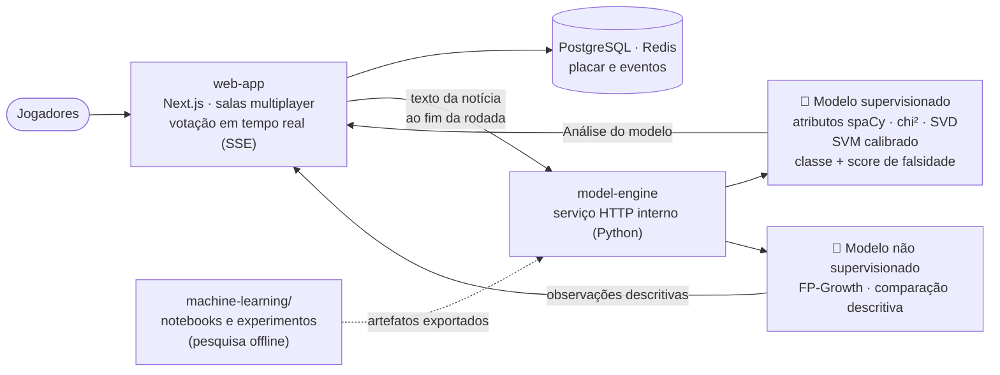

# Olimpo — Fake News AI

Plataforma gamificada de letramento midiático: jogadores classificam notícias sob pressão de tempo, e um classificador de machine learning (SVM com atributos linguísticos do spaCy) estima a classe e o score de falsidade de cada texto.

<!-- DEMO -->

## O problema

Decidir se uma manchete é confiável leva poucos segundos, e palestras e cartilhas têm pouco efeito sobre esse hábito. O Olimpo transforma a checagem em um jogo multiplayer cronometrado, em que a pessoa escolhe entre "fake", "real" e "preciso checar", e depois vê o gabarito, a votação da sala e a análise do modelo.

## Como funciona



A pontuação do jogo vem do **gabarito cadastrado** da notícia, e não do modelo. A "Análise do modelo" aparece depois do encerramento coletivo da rodada, mostra a classe estimada, o score de falsidade e as contribuições do texto, e **não confirma acontecimentos nem fontes**.

## Resultados do modelo

Números do relatório [`machine-learning/supervised-learning/RESULTADOS.md`](machine-learning/supervised-learning/RESULTADOS.md) (corpus Fake.br):

| Medida | Valor |
|---|---|
| F1 macro em validação cruzada (5 folds) | 0,9295 ± 0,0081 |
| F1 macro no teste interno (sem calibração) | 0,9243 |
| AUC no teste interno (sem calibração) | 0,9789 |
| F1 macro externo, títulos do FakeRecogna (exploratório) | 0,6378 |
| AUC externo, títulos do FakeRecogna (exploratório) | 0,6774 |

O desempenho cai bastante no teste externo, em títulos de outra fonte. Por isso o modelo é apresentado como apoio à análise, não como prova de veracidade.

Pontos de IA no código:

- **Machine learning clássico supervisionado:** atributos linguísticos extraídos com spaCy (`pt_core_news_sm`), seleção de atributos por chi², redução de dimensionalidade (SVD) e SVM calibrado. Política de decisão com limiares 0,35 e 0,65 e mínimo de 30 palavras.
- **Análise não supervisionada:** padrões FP-Growth sobre atributos do texto, usados em comparações descritivas.
- **LLM, tool calling, voz e MCP:** não encontrei chamadas a LLM, nem uso de tool calling, voz ou MCP no código do `web-app` e do `model-engine`.

## Stack

- Web: Next.js 16, React 19, TypeScript, Drizzle ORM, PostgreSQL, Redis e SSE
- ML: Python, scikit-learn, spaCy, joblib, notebooks Jupyter
- Qualidade: Vitest, Playwright e documentação com OpenSpec
- Site de documentação (`docu-app`) em Next.js

## Meu papel

Fiquei com a frente de **aprendizado supervisionado**:

- preparação de dados e treino de regressão logística e SVM nos notebooks de `machine-learning/supervised-learning`;
- experimentos de redução de dimensionalidade e os achados registrados;
- SVM com metadados do spaCy e exportação do modelo;
- o entregável final (relatório e artigo) e suas figuras, além de contribuições pontuais na documentação.

O `web-app` e o `model-engine` foram desenvolvidos por outras pessoas do time. Esta é a minha cópia (fork) do repositório da equipe.

## Contexto

Projeto da **Residência em IA, Formação avançada em Inteligência Artificial** ([página do programa](https://formacao.eldorado.org.br/residencia-ia-pucc)), em parceria entre a PUC-Campinas (PUCC) e o Instituto de Pesquisas Eldorado.

## Como rodar localmente

Requisitos: Node.js 22.22 ou superior (24.x recomendado), pnpm, PostgreSQL e Redis.

```bash
git clone https://github.com/Jp-mainieri/residenciaia-1-fakenews.git
cd residenciaia-1-fakenews/web-app
pnpm install
cp .env.example .env.local
pnpm db:migrate
pnpm dev          # http://127.0.0.1:3000
```

Para reproduzir os experimentos de ML, use os notebooks e os requisitos em `machine-learning/` (`requirements.txt`). O serviço de modelos está descrito em [`model-engine/README.md`](model-engine/README.md).

O README original da equipe, com as decisões de arquitetura e a estratégia de testes, está em [`docs/olimpo-readme-original.md`](docs/olimpo-readme-original.md).
